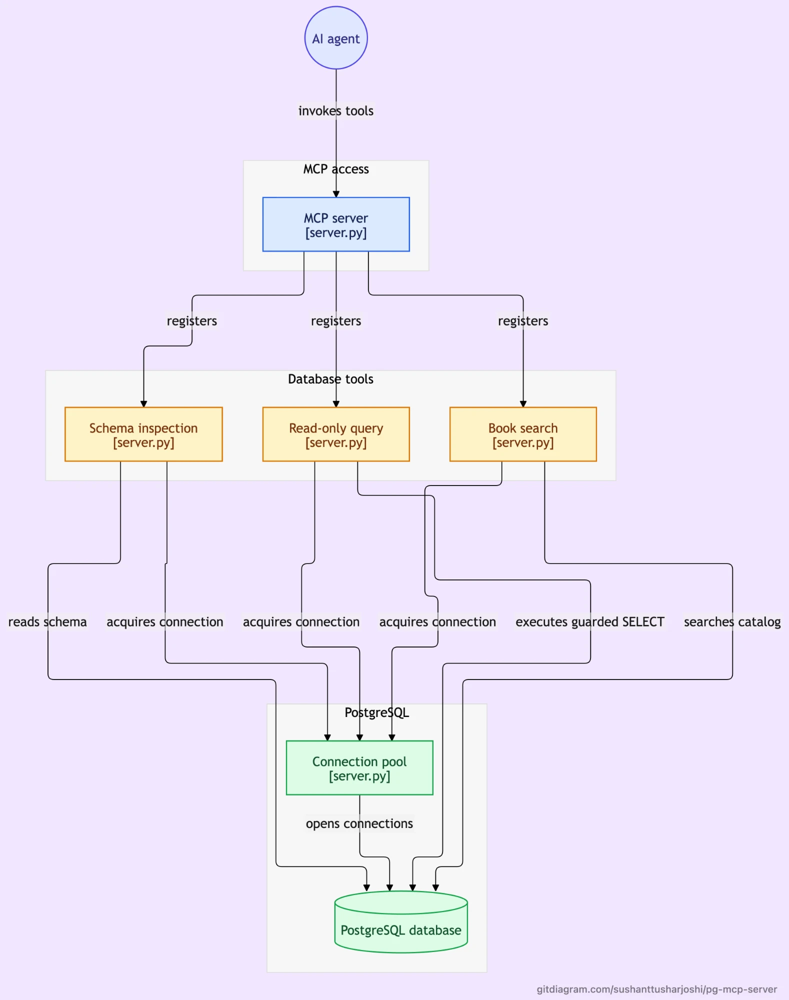

# pg-mcp-server

An MCP server that gives AI agents safe, read-only access to a PostgreSQL database. Ships with a Docker Compose setup and seed data so you can try it locally.

## Architecture



## Tools

| Tool | Purpose |
|---|---|
| `inspect_schema` | List all tables (with row counts), or describe a single table's columns, types, and constraints |
| `query` | Run one read-only SELECT (values bound as `$1`, `$2`, ...) with a row cap and a statement timeout |
| `search_books` | Search books by title, author, or genre with optional rating and stock filters |

## Quick start

### Prerequisites

- Docker and Docker Compose
- Python 3.10+
- `uv` (recommended) or `pip`

### 1. Start Postgres

```bash
cp .env.example .env   # then set POSTGRES_PASSWORD
docker compose up -d
```

This starts Postgres 16 with the bookstore schema and 20 sample books. A read-only database role (`mcp_readonly`) is created automatically. The port is bound to `127.0.0.1` only, so the database is not reachable from other machines on your network.

### 2. Install the server

```bash
uv pip install -e .
```

Or with pip:

```bash
pip install -e .
```

### 3. Run the server

With the MCP inspector (for testing):

```bash
mcp dev src/pg_mcp/server.py
```

Or directly via stdio:

```bash
python -m pg_mcp.server
```

## Configuration

All settings are via environment variables with sensible defaults:

| Variable | Default | Description |
|---|---|---|
| `PG_HOST` | `localhost` | Postgres host |
| `PG_PORT` | `5432` | Postgres port |
| `PG_DATABASE` | `bookstore` | Database name |
| `PG_USER` | `mcp_readonly` | Database user |
| `PG_PASSWORD` | `mcp_readonly` | Database password |
| `QUERY_ROW_LIMIT` | `100` | Max rows returned per query (hard cap 500) |
| `STATEMENT_TIMEOUT_MS` | `5000` | Query timeout in milliseconds |

## Connecting to Claude Code

Add to your MCP config (`.claude/mcp.json` or similar):

```json
{
  "mcpServers": {
    "postgres": {
      "command": "python",
      "args": ["-m", "pg_mcp.server"],
      "env": {
        "PG_HOST": "localhost",
        "PG_DATABASE": "bookstore",
        "PG_USER": "mcp_readonly",
        "PG_PASSWORD": "mcp_readonly"
      }
    }
  }
}
```

## Example agent interaction

```
User: What tables are in the database?

Agent calls: inspect_schema()
→ Tables in database:
    authors (8 rows)
    books (20 rows)
    genres (5 rows)

User: Show me the schema of the books table.

Agent calls: inspect_schema(table_name="books")
→ Table: books
  Columns:
    id: integer NOT NULL DEFAULT nextval('books_id_seq')
    title: text NOT NULL
    author_id: integer NOT NULL
    genre_id: integer NOT NULL
    published_year: integer NOT NULL
    isbn: text
    pages: integer
    price: numeric NOT NULL
    rating: numeric
    in_stock: boolean DEFAULT true
    created_at: timestamp with time zone DEFAULT now()
  Constraints:
    author_id: FOREIGN KEY -> authors(id)
    genre_id: FOREIGN KEY -> genres(id)

User: Find science fiction books rated above 4.

Agent calls: search_books(search_term="Science Fiction", min_rating=4.0)
→ Found 4 results:
  - Kindred by Octavia Butler (1979)
    Genre: Science Fiction | 264pp | $14.99 | Rating: 4.6/5 | In stock
  - Parable of the Sower by Octavia Butler (1993)
    Genre: Science Fiction | 345pp | $15.99 | Rating: 4.5/5 | In stock
  - The Dispossessed by Ursula K. Le Guin (1974)
    Genre: Science Fiction | 387pp | $16.99 | Rating: 4.5/5 | In stock
  - The Left Hand of Darkness by Ursula K. Le Guin (1969)
    Genre: Science Fiction | 304pp | $15.99 | Rating: 4.4/5 | In stock

User: What's the average price by genre?

Agent calls: query(sql="SELECT g.name, round(avg(b.price), 2) AS avg_price, count(*) AS books FROM books b JOIN genres g ON g.id = b.genre_id GROUP BY g.name ORDER BY avg_price DESC")
→ name             avg_price  books
  Science Fiction  16.79      5
  Magical Realism  16.49      2
  Literary Fiction 15.08      10
  Short Stories    13.99      2
  Fantasy          11.99      1
```

## Security model

Read-only is enforced by Postgres itself, so it does not depend on the agent behaving. The `query` tool puts these layers around every call:

1. **Keyword blocklist**: SQL containing INSERT, UPDATE, DELETE, DROP, ALTER, CREATE, TRUNCATE, GRANT, REVOKE, COPY or EXECUTE is refused before it reaches the database. It is an early refusal, not the security boundary.
2. **Read-only transaction**: the query runs inside `BEGIN READ ONLY`, so Postgres rejects any write.
3. **Dedicated role**: `mcp_readonly` only has SELECT on the bookstore tables, and `seed/init.sql` revokes `pg_terminate_backend`, `pg_cancel_backend` and `pg_notify` from PUBLIC so the role cannot end other sessions or send messages.
4. **Statement timeout**: queries running longer than `STATEMENT_TIMEOUT_MS` (default 5s) are cancelled by Postgres.
5. **Row cap**: rows are read from a cursor and reading stops at `QUERY_ROW_LIMIT`. The agent's SQL is never wrapped in a string, so a trailing comment cannot lift the cap.

Values passed in `params` are bound by asyncpg. The SQL text itself is written by the agent, which is why layers 2 to 5 exist.

### Residual risks

- The blocklist is a regular expression, not a SQL parser; layers 2 to 5 are what hold.
- Output is capped by rows, not bytes, so very wide rows can still produce a large response.
- In stdio mode the only identity check is the local operating-system user.
- The revokes live in `seed/init.sql`, which only runs on a fresh volume. After upgrading, run `docker compose down -v` once.
- Not tested against Amazon RDS.

## Teardown

```bash
docker compose down -v
```
