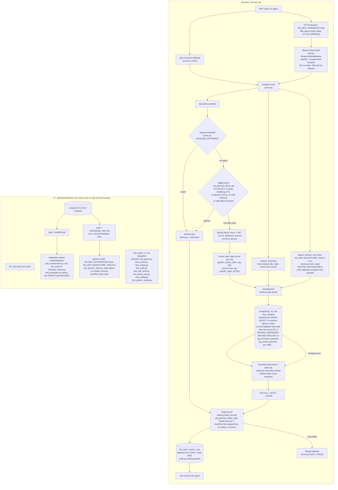

# Architecture

How a tool call travels through the code on `main`, and what CI runs. Every box names the file that does the work.

Notes, each checked against the code:

- Only `query` runs inside `BEGIN READ ONLY` with a statement timeout. `inspect_schema` and `search_books` run SQL the server wrote, with values bound as parameters, as the same `mcp_readonly` role ([server.py](../src/pg_mcp/server.py)).
- `build_mcp` registers `inspect_schema` and `query` always and `search_books` only when `PG_MCP_BOOKSTORE_TOOLS` is on (the default). With it off, the server is generic: the same two tools and the same layers against whatever database and role `PG_*` names. CI proves this on [seed/sample_clinic.sql](../seed/sample_clinic.sql) ([test_generic_clinic.py](../tests/integration/test_generic_clinic.py)).
- Refusals, successes and errors all go through `_Call`, so every call writes an audit record before anything is returned ([server.py](../src/pg_mcp/server.py), [audit.py](../src/pg_mcp/audit.py)). Database error messages are fenced like rows, because Postgres can quote row values in them.
- In HTTP mode the middleware also returns `413` for a body over 1 MB and `400` for a body that is not JSON or has duplicate keys, and passes the token ID on as the audit `caller` ([auth.py](../src/pg_mcp/auth.py)). In stdio mode the caller is `stdio`.
- Locally, [docker-compose.yml](../docker-compose.yml) runs `postgres:16-alpine` on `127.0.0.1` and loads the same `seed/init.sql`.
