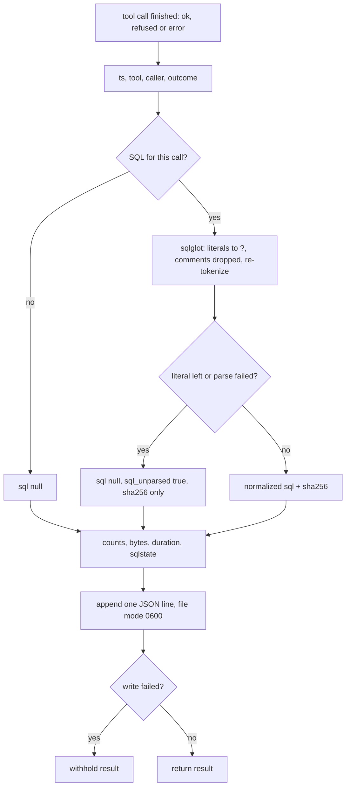

# Card: audit writer

Code: `build_record` and `AuditLog.write` in [`src/pg_mcp/audit.py`](../../src/pg_mcp/audit.py), `redact_sql` in [`src/pg_mcp/sql_guard.py`](../../src/pg_mcp/sql_guard.py), the fail-closed check in `_Call` in [`src/pg_mcp/server.py`](../../src/pg_mcp/server.py)

## The question

"How do you audit what an agent ran without logging the data it sent?"

## How to catch it

Log the shape of the query, not its values. Parse the SQL and replace every literal with `?`, drop comments, keep a hash of the original for correlation, and store counts instead of rows. If the shape cannot be produced safely, store the hash only. If the record cannot be written, do not hand back the result.

## Flowchart

## Slips (what changed)

- There was no audit trail. Now every tool call writes one line, refusals and errors included. Test: `tests/test_audit.py::test_every_tool_writes_a_record`.
- The first draft only blanked plain strings and numbers. `$$dollar$$`, `E''`, `U&''`, bit and hex strings and `INTERVAL '17 days'` are separate node types in sqlglot, so they are listed explicitly, and a token re-check refuses anything that slips through. Test: `test_redaction_blanks_every_literal_kind`.

## Interviewer questions

| Question | How the code answers |
|---|---|
| Where are parameter values? | Never written; only `param_count`. `test_query_record_has_no_literals_or_params` reads the record back and searches for each value. |
| Why not log the Postgres error message? | It can quote row values (`invalid input syntax for type integer: "..."`). Only the SQLSTATE is kept. |
| What if the disk is full? | `write` raises, `_Call` returns "result withheld". Test: `test_audit_failure_withholds_the_result`. |
| Can the hash leak data? | Someone with the file can confirm a guessed SQL string. Documented in `docs/audit-log.md`; keep the file private. |

## Twists

- "Who called?" `caller` is the token ID in HTTP mode, `stdio` otherwise.
- "Tamper evidence?" Not provided; ship the file to a log store if you need it.
