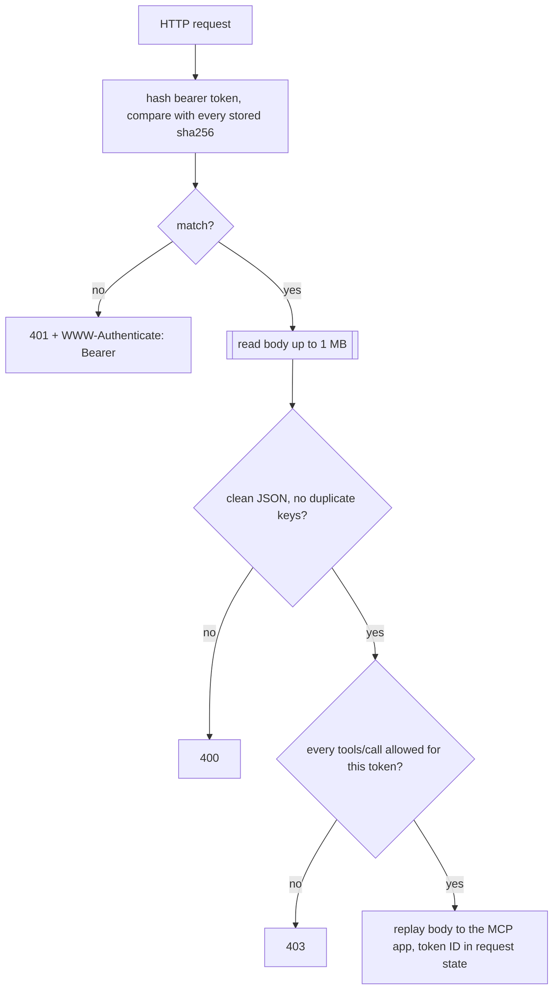

# Card: auth check

Code: `BearerAuthMiddleware` and `verify_token` in [`src/pg_mcp/auth.py`](../../src/pg_mcp/auth.py)

## The question

"How do you check an API token without leaking it through timing or logs?"

## How to catch it

Store only a hash of each token. Hash what the client presents and compare with `hmac.compare_digest` against every stored hash, without stopping at the first match. Never log the header. Decide 401 (who are you) before 403 (what may you do).

## Flowchart

## Slips (what changed)

- stdio only had the local operating-system user as identity. HTTP mode adds tokens with per-tool lists.
- Duplicate JSON keys are refused, after noticing that `{"name":"inspect_schema","name":"query"}` could be read one way by the middleware and another by a different parser. Test: `tests/test_http_auth.py::test_duplicate_keys_are_400`.

## Interviewer questions

| Question | How the code answers |
|---|---|
| Why hash tokens at rest? | A leaked env file or process dump shows hashes, not usable tokens. `load_tokens` refuses anything that is not 64 hex characters. |
| Why constant time? | `==` on bytes can stop at the first difference. `test_compare_is_constant_time_and_checks_every_entry` checks one `compare_digest` call per entry. |
| How do you know tokens are not logged? | `test_tokens_never_logged` captures all loggers at DEBUG during good and bad requests and searches for the tokens; the audit file and error bodies are checked too. |
| Is this what the MCP spec asks for? | No. The spec describes OAuth 2.1-based authorization for HTTP. This is a static-token simplification for a single operator, stated in SECURITY.md. |

## Twists

- "A token with access to `inspect_schema` only calls `tools/list`?" Allowed: listing is not calling. Test: `test_tools_list_needs_a_token_but_no_tool_right`.
- "Rotation?" Add a second entry with the new hash, move the client, remove the old entry, restart.
- "Exposed beyond loopback?" Default bind is `127.0.0.1`; other binds need `PG_MCP_ALLOWED_HOSTS` and should sit behind TLS.
