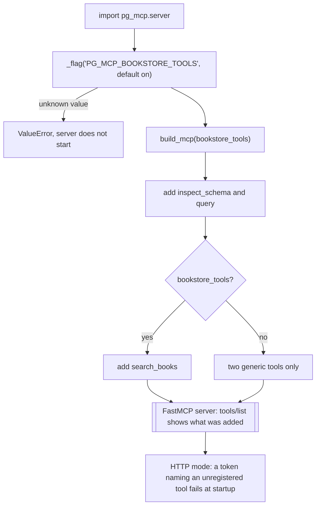

# Card: build_mcp

Code: `build_mcp` in [`src/pg_mcp/server.py`](../../src/pg_mcp/server.py)

## The question

"How does one server work on any Postgres without exposing tools that assume one schema?"

## How to catch it

Split the tools by what they assume. `inspect_schema` and `query` only ask the catalog or run the agent's SQL, so they fit any schema. `search_books` names `books`, `authors` and `genres`, so it is registered only when `PG_MCP_BOOKSTORE_TOOLS` is on. The flag is read once at import; an unknown value stops startup instead of guessing. Every security layer lives inside the tools and the database role, so the flag cannot weaken them.

## Flowchart

## Slips (what changed)

- `search_books` was always registered with `@mcp.tool()`, so a server pointed at any other database advertised a tool that could only fail. Now registration goes through `build_mcp`. Tests: `tests/test_generic_mode.py::test_generic_server_has_only_the_generic_tools`, `test_env_flag_off_at_import_drops_search_books`.
- The default stays on, so the bookstore quick start, client configs and HTTP token lists keep working unchanged. Test: `tests/test_generic_mode.py::test_default_module_server_keeps_all_three_tools`.

## Interviewer questions

| Question | How the code answers |
|---|---|
| Does generic mode loosen anything? | No. The generic tools are the same function objects with the same schemas either way (`test_tool_schemas_are_unchanged_by_the_flag`); read-only, the role, the caps, the fence and the audit log are inside them or in the database. |
| How is generic mode proven on a real database? | CI loads `seed/sample_clinic.sql` into a second database and runs `tests/integration/test_generic_clinic.py` with only env changed, including a real MCP stdio client (`test_quick_start_over_stdio`). |
| What if a token still lists `search_books` with the flag off? | `load_tokens` rejects unknown tools, so the HTTP server refuses to start (`test_http_token_naming_an_unregistered_tool_fails_at_startup`). |
| Why not detect the bookstore tables at startup instead of a flag? | That needs a database round trip before the server can list its tools, and a schema that happens to have a `books` table would get a tool its owner never chose. An explicit flag is predictable. |

## Twists

- "Why default on, if generic is the point?" Backward compatibility: existing configs expect `search_books`. Any other database sets `PG_MCP_BOOKSTORE_TOOLS=0`.
- "Can the agent turn the flag on?" No. It is read from the server's environment at import, never from a tool argument.
