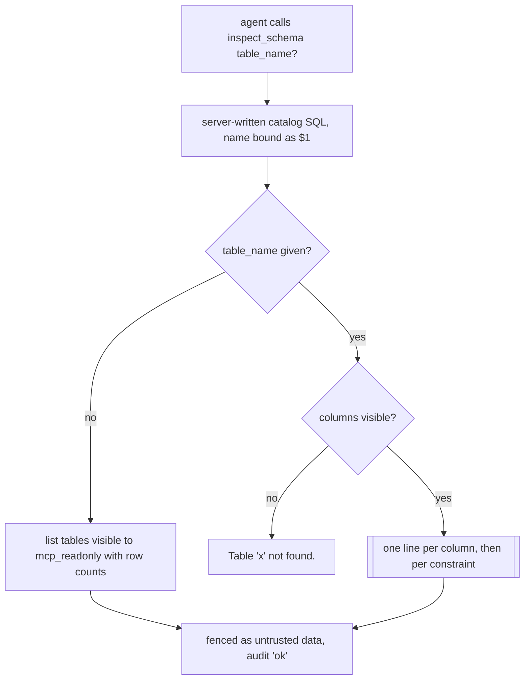

# Card: inspect_schema

Code: `inspect_schema` in [`src/pg_mcp/server.py`](../../src/pg_mcp/server.py)

## The question

"How does an agent learn the schema without being able to read tables it should not?"

## How to catch it

Ask the catalog as the same restricted role. `information_schema` only shows objects the current role has some privilege on, so the allowlist in the database also decides what the agent can discover. Constraints are the exception: `information_schema.table_constraints` hides tables where the role holds only SELECT, so they come from `pg_catalog.pg_constraint`, filtered with `has_table_privilege(..., 'SELECT')` to keep the same rule. The table name the agent passes is a bound parameter, never part of the SQL text.

## Flowchart

## Slips (what changed)

- The grant was `GRANT SELECT ON ALL TABLES` plus default privileges, so any new table became readable and visible. Now three tables are granted by name. Test: `tests/integration/test_privileges.py::test_new_table_is_not_readable` checks that a new table is neither readable nor listed.
- Output is now fenced: column defaults and constraint names are database text too.

## Interviewer questions

| Question | How the code answers |
|---|---|
| Can the agent inject through `table_name`? | No, it is passed as `$1` to a fixed query. |
| Does "not found" leak that a hidden table exists? | Missing and ungranted tables give the same answer, because the catalog hides both. |
| The listing counts rows with `query_to_xml`; is that dynamic SQL? | Yes, written by the server with `format('%I')` over names from `information_schema`, which only holds granted tables. Agents cannot call `query_to_xml` through `query`: the parser refuses it. |

## Twists

- "A table name with a newline and fake instructions?" It is printed inside the untrusted-data fence, and the fence id is random per response.
- "Hundreds of tables?" The byte cap applies here too. Test: `tests/test_output.py::test_byte_cap_on_every_tool`.
