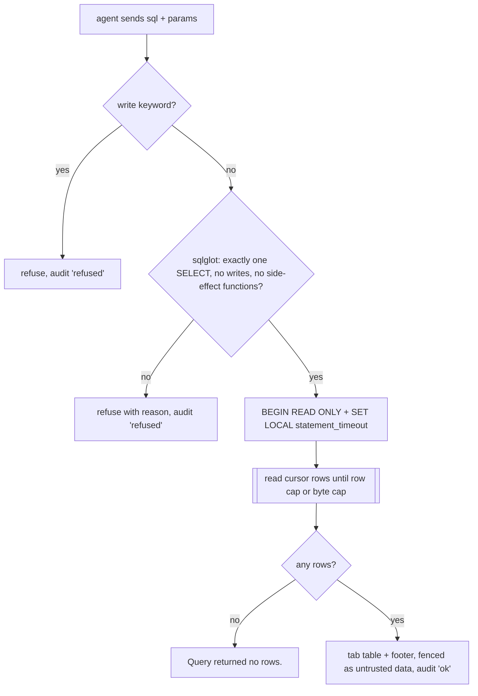

# Card: query

Code: `query` in [`src/pg_mcp/server.py`](../../src/pg_mcp/server.py), parser in [`src/pg_mcp/sql_guard.py`](../../src/pg_mcp/sql_guard.py)

## The question

"How do you let an agent query a database without letting it write?"

## How to catch it

The agent writes the SQL, so no string check can be the boundary. Put the boundary in Postgres (read-only transaction, a role that can only SELECT three tables, a timeout) and use the Python checks only to refuse early with a clear reason. Never wrap the agent's SQL inside your own SQL string.

## Flowchart

## Slips (what changed)

- Nov 4 audit: the cap was `SELECT * FROM (agent sql) LIMIT n`, so a trailing `--` commented the LIMIT out. Now rows are read from a cursor and reading stops at the cap. Test: `tests/test_query_cap.py`.
- Added the sqlglot layer: one statement only, data-modifying CTEs refused. Test: `tests/test_sql_guard.py`.
- Added a byte cap because 100 very wide rows can still be megabytes. Test: `tests/test_output.py::test_query_stops_reading_at_the_byte_cap`.

## Interviewer questions

| Question | How the code answers |
|---|---|
| Why not just block INSERT/UPDATE/DELETE with a regex? | It is kept as the first check, but `query_to_xml(concat('DEL','ETE ...'))` hides the keyword. The read-only transaction and role privileges stop it; `tests/integration/test_containment.py::test_database_alone_rejects` runs the corpus with the Python layers bypassed. |
| What about `WITH x AS (DELETE ... RETURNING *) SELECT ...`? | The parser walks the whole tree and refuses any Delete/Insert/Update node; Postgres also refuses it inside READ ONLY. |
| Two statements in one string? | The parser counts statements, and asyncpg's extended protocol refuses multiple commands in a prepared statement. |
| `pg_sleep(600)`? | Allowed by the parser on purpose; `SET LOCAL statement_timeout` cancels it. Test: `test_pg_sleep_is_cancelled_by_statement_timeout`. |
| Why is the limit not added to the SQL? | Anything appended to agent SQL can be commented out. The cursor stops reading instead. |

## Twists

- "What if sqlglot cannot parse valid Postgres?" It refuses (fails closed). The agent gets a reason and can rewrite.
- "Session state on a pooled connection?" `set_config(..., false)` and advisory locks are refused by the parser, and asyncpg resets the connection on release. Test: `test_pool_reset_clears_session_state`.
- "A single row of 500 MB?" The byte cap trims output, but the row is still built in memory first. Listed as a residual risk in SECURITY.md.
