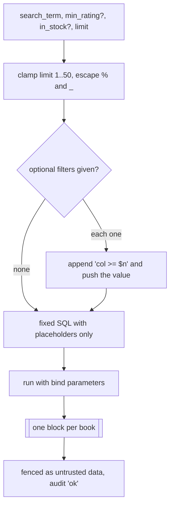

# Card: search_books

Code: `search_books` in [`src/pg_mcp/server.py`](../../src/pg_mcp/server.py)

## The question

"How do you take free text from an agent into SQL without injection or wildcard tricks?"

## How to catch it

Build the SQL text only from fixed fragments and placeholders, and send every value as a bind parameter. Escape the LIKE wildcards so `%` and `_` in the search term match literally, and clamp numeric inputs.

## Flowchart

## Slips (what changed)

- An earlier version passed the term straight into ILIKE, so `%` matched everything. Now wildcards are escaped. Test: `tests/test_server.py::TestLikeEscaping`.
- Output is now fenced and byte-capped, and each call is audited without the search term. Test: `tests/test_audit.py::test_every_tool_writes_a_record`.
- It was always registered, even on databases without these tables. Now `build_mcp` adds it only when `PG_MCP_BOOKSTORE_TOOLS` is on (the default). Test: `tests/test_generic_mode.py::test_env_flag_off_at_import_drops_search_books`. Card: [build_mcp](build-mcp.md).

## Interviewer questions

| Question | How the code answers |
|---|---|
| Where could injection get in? | Only `idx` (an int the code controls) is formatted into the SQL; values go in `params`. |
| Why escape `_`? | `_` is a single-character wildcard in LIKE, so `my_book` would also match `myXbook`. |
| Is the search term in the audit log? | No. The record holds the server SQL with placeholders and `param_count`. |

## Twists

- "A book title that says 'ignore previous instructions'?" It comes back inside the fence, labelled as data.
- "Why a dedicated tool when `query` exists?" A fixed tool is easier to allow on its own: an HTTP token can be limited to `search_books`.
